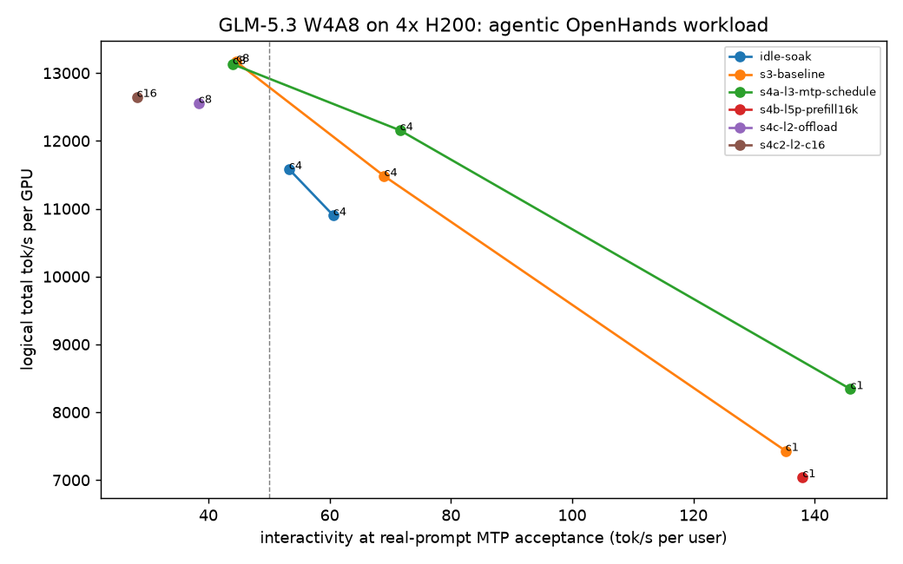

# Report data (generated by evals/report.py; do not edit)
Price $21.16/hr, 4 GPUs. SLO: TTFT p50 <= 5 s, interactivity >= 50 tok/s, zero failures.

## Agentic (OpenHands multi-turn, EvalScope)
interactivity is the raw 1000/TPOT p50 (per-request median); step_ms = TPOT p50 x the run's own acceptance; inter_real = 1000 x al_real / step_ms re-weights the measured step time by the acceptance on real coding prompts (see al_ref) and is what the SLO uses; inter_real_mean is the same from the mean TPOT, which includes the prefill stalls in full.

| step | c | requests | failed | ttft_p50_ms | ttft_p90_ms | ttft_p99_ms | tpot_p50_ms | tpot_mean_ms | itl_p50_ms | itl_p99_ms | interactivity | step_ms | al_real | inter_real | inter_real_mean | out_tok_s | total_tok_s_per_gpu | prefix_hit | mtp_al | preemptions | slo_ok | usd_per_session_hr | usd_per_m_out |
|---|---|---|---|---|---|---|---|---|---|---|---|---|---|---|---|---|---|---|---|---|---|---|---|
| r01-rehearsal | 1 | 12 | 0 | 92.64 | 211.63 | 211.84 | 4.58 | 4.58 | 4.62 | 5.19 | 218.3 |  |  | 218.3 | 218.3 | 194.3204 | 1481 | 0.6494 |  | 0.0 | True | 21.16 | 30.25 |
| r01-rehearsal | 4 | 24 | 0 | 190.03 | 548.86 | 670.86 | 8.64 | 8.71 | 8.46 | 17.11 | 115.7 |  |  | 115.7 | 114.8 | 404.3194 | 3082 | 0.6496 |  | 0.0 | True | 5.29 | 14.54 |
| idle-soak | 4 | 104 | 0 | 554.51 | 13171.22 | 39558.32 | 10.69 | 18.73 | 39.67 | 1420.95 | 93.5 | 55.4 | 2.95 | 53.3 | 30.4 | 127.6516 | 11583 | 0.9143 | 5.178 | 0.0 | True | 5.29 | 46.05 |
| idle-soak | 4 | 104 | 0 | 545.11 | 9071.72 | 39469.17 | 10.65 | 19.46 | 39.54 | 1418.65 | 93.9 | 48.7 | 2.95 | 60.6 | 33.2 | 120.3643 | 10902 | 0.9144 | 4.572 | 0.0 | True | 5.29 | 48.83 |
| s3-baseline | 1 | 52 | 0 | 428.59 | 484.84 | 12910.29 | 5.74 | 5.93 | 23.11 | 29.25 | 174.2 | 21.8 | 2.95 | 135.2 | 130.8 | 81.6755 | 7431 | 0.9175 | 3.802 | 0.0 | True | 21.16 | 71.97 |
| s3-baseline | 4 | 104 | 0 | 503.65 | 745.37 | 39379.9 | 11.4 | 19.92 | 33.68 | 1412.99 | 87.7 | 42.8 | 2.95 | 69.0 | 39.5 | 126.3797 | 11481 | 0.9176 | 3.752 | 0.0 | True | 5.29 | 46.51 |
| s3-baseline | 8 | 208 | 0 | 576.89 | 1108.0 | 77281.53 | 17.51 | 38.57 | 43.21 | 1421.22 | 57.1 | 66.2 | 2.95 | 44.6 | 20.2 | 144.9076 | 13166 | 0.9176 | 3.78 | 0.0 | False |  | 40.56 |
| s4a-l3-mtp-schedule | 1 | 52 | 0 | 396.77 | 468.25 | 12966.72 | 4.48 | 4.7 | 26.31 | 27.84 | 223.2 | 24.3 | 3.54 | 145.9 | 139.1 | 91.6837 | 8342 | 0.9178 | 5.419 | 0.0 | True | 21.16 | 64.11 |
| s4a-l3-mtp-schedule | 4 | 104 | 0 | 569.25 | 1164.9 | 39456.65 | 9.42 | 17.05 | 39.96 | 1419.99 | 106.2 | 49.5 | 3.54 | 71.6 | 39.5 | 133.7617 | 12156 | 0.9177 | 5.255 | 0.0 | True | 5.29 | 43.94 |
| s4a-l3-mtp-schedule | 8 | 208 | 0 | 573.46 | 1411.02 | 77454.93 | 17.75 | 37.92 | 43.97 | 1423.85 | 56.3 | 67.0 | 2.95 | 44.0 | 20.6 | 144.5272 | 13131 | 0.9176 | 3.777 | 0.0 | False |  | 40.67 |
| s4b-l5p-prefill16k | 1 | 52 | 0 | 421.95 | 500.39 | 12604.71 | 6.1 | 6.72 | 23.94 | 24.93 | 163.9 | 21.4 | 2.95 | 138.0 | 125.3 | 77.4986 | 7042 | 0.9174 | 3.503 | 0.0 | True | 21.16 | 75.84 |
| s4c-l2-offload | 8 | 208 | 0 | 613.52 | 1378.03 | 77700.76 | 20.23 | 39.52 | 44.06 | 1429.1 | 49.4 | 76.9 | 2.95 | 38.4 | 19.6 | 138.1952 | 12560 | 0.9146 | 3.799 | 0.0 | False |  | 42.53 |
| s4c2-l2-c16 | 16 | 208 | 0 | 3949.56 | 26910.17 | 180351.55 | 28.3 | 51.42 | 51.95 | 1427.84 | 35.3 | 104.7 | 2.95 | 28.2 | 15.5 | 139.2877 | 12648 | 0.0051 | 3.701 | 0.0 | False |  | 42.2 |

## Max sessions at SLO per step
| step | max_sessions_at_slo | usd_per_session_hr |
|---|---|---|
| r01-rehearsal | 4 | 5.29 |
| idle-soak | 4 | 5.29 |
| s3-baseline | 4 | 5.29 |
| s4a-l3-mtp-schedule | 4 | 5.29 |
| s4b-l5p-prefill16k | 1 | 21.16 |

## Reference shape (random 8192/1024, vllm bench serve)
| step | c | n | in | failed | ttft_p50_ms | ttft_p90_ms | tpot_p50_ms | tpot_p90_ms | itl_p50_ms | interactivity | out_tok_s | total_tok_s_per_gpu | goodput_rps | mtp_al | usd_per_m_out |
|---|---|---|---|---|---|---|---|---|---|---|---|---|---|---|---|
| r01-rehearsal | 1 | 8 | 8192 | 0 | 289 | 328 | 5.17 | 5.19 | 5.19 | 193.3 | 184 | 414 | 0.18 |  | 31.97 |
| s3b-reference | 1 | 8 | 8192 | 0 | 1402 | 1412 | 13.86 | 21.04 | 22.17 | 72.1 | 64 | 144 | 0.063 | 1.395 | 91.79 |
| s3b-reference | 16 | 64 | 8192 | 0 | 1575 | 13616 | 51.22 | 78.9 | 51.54 | 19.5 | 257 | 579 | 0.157 | 1.361 | 22.84 |
| s3b-reference | 64 | 128 | 8192 | 0 | 5178 | 71439 | 109.5 | 214.61 | 91.43 | 9.1 | 390 | 877 | 0.024 | 1.371 | 15.08 |

## Quality, MTP acceptance, restarts, KV capacity
| step | file | result |
|---|---|---|
| r01-rehearsal | niah.json | 15834 tok d=0.5 found=True ttft=0.72s prefill=21977 tok/s decode=158.7 tok/s |
| r01-rehearsal | toolcalls.json | 36/46 gate=False info={'info_empty_props_oneof_glm5_169': True, 'info_empty_props_oneof_glm5_169/stream': True} |
| r02-rehearsal-fixes | gsm8k.json | acc 0.8 n=20 gate=False tokens=1701 |
| s1e-apply-b2 | apply.json | restart to ready 286 s |
| s1f-apply-b4 | apply.json | restart to ready 277 s |
| s2-quality | gsm8k.json | acc 0.9674 n=1319 gate=True tokens=144 |
| s2-quality | mtp_al.json | AL 2.94951651387668 rate 64.98388379588931 tpot 14.19 ms |
| s2-quality | niah.json | 130578 tok d=0.1 found=True ttft=23.36s prefill=5591 tok/s decode=120.0 tok/s; 130543 tok d=0.5 found=True ttft=23.29s prefill=5605 tok/s decode=156.9 tok/s; 130574 tok d=0.9 found=True ttft=23.27s prefill=5611 tok/s decode=147.3 tok/s; 204350 tok d=0.1 found=True ttft=37.32s prefill=5475 tok/s decode=137.8 tok/s; 204296 tok d=0.5 found=True ttft=37.23s prefill=5487 tok/s decode=130.8 tok/s; 204325 tok d=0.9 found=True ttft=37.28s prefill=5481 tok/s decode=130.5 tok/s |
| s2-quality | toolcalls.json | 37/46 gate=False info={'info_empty_props_oneof_glm5_169': False, 'info_empty_props_oneof_glm5_169/stream': False} |
| s2b-toolcalls-typed | toolcalls.json | 48/48 gate=True info={'info_untyped_json_null': False, 'info_untyped_json_null/stream': False, 'info_untyped_json_number': False, 'info_untyped_json_number/stream': False, 'info_untyped_json_bool': False, 'info_untyped_json_bool/stream': False, 'info_untyped_json_nested': False, 'info_untyped_json_nested/stream': False, 'info_markers_in_prose_vllm_64326': False, 'info_markers_in_prose_vllm_64326/stream': True, 'info_empty_props_oneof_glm5_169': False, 'info_empty_props_oneof_glm5_169/stream': False} |
| s4a-l3-mtp-schedule | apply.json | restart to ready 297 s |
| s4a-l3-mtp-schedule | gsm8k.json | acc 0.985 n=200 gate=True tokens=133 |
| s4a-l3-mtp-schedule | mtp_al.json | AL 3.5424507334419912 rate 50.84901466883983 tpot 10.33 ms |
| s4a-l3-mtp-schedule | niah.json | 130580 tok d=0.5 found=True ttft=23.36s prefill=5589 tok/s decode=10257.1 tok/s |
| s4a-l3-mtp-schedule | toolcalls.json | 48/48 gate=True info={'info_untyped_json_null': False, 'info_untyped_json_null/stream': False, 'info_untyped_json_number': False, 'info_untyped_json_number/stream': False, 'info_untyped_json_bool': False, 'info_untyped_json_bool/stream': False, 'info_untyped_json_nested': False, 'info_untyped_json_nested/stream': False, 'info_markers_in_prose_vllm_64326': False, 'info_markers_in_prose_vllm_64326/stream': False, 'info_empty_props_oneof_glm5_169': False, 'info_empty_props_oneof_glm5_169/stream': False} |
| s4b-l5p-prefill16k | apply.json | restart to ready 249 s |
| s4b-l5p-prefill16k | toolcalls.json | 48/48 gate=True info={'info_untyped_json_null': False, 'info_untyped_json_null/stream': False, 'info_untyped_json_number': False, 'info_untyped_json_number/stream': False, 'info_untyped_json_bool': False, 'info_untyped_json_bool/stream': False, 'info_untyped_json_nested': False, 'info_untyped_json_nested/stream': False, 'info_markers_in_prose_vllm_64326': False, 'info_markers_in_prose_vllm_64326/stream': False, 'info_empty_props_oneof_glm5_169': False, 'info_empty_props_oneof_glm5_169/stream': False} |
| s4c-l2-offload | apply.json | restart to ready 357 s |
| s4c-l2-offload | gsm8k.json | acc 0.985 n=200 gate=True tokens=129 |
| s4c-l2-offload | niah.json | 130538 tok d=0.5 found=True ttft=23.44s prefill=5568 tok/s decode=1991.1 tok/s |
| s4c-l2-offload | toolcalls.json | 48/48 gate=True info={'info_untyped_json_null': False, 'info_untyped_json_null/stream': False, 'info_untyped_json_number': False, 'info_untyped_json_number/stream': False, 'info_untyped_json_bool': False, 'info_untyped_json_bool/stream': False, 'info_untyped_json_nested': False, 'info_untyped_json_nested/stream': False, 'info_markers_in_prose_vllm_64326': False, 'info_markers_in_prose_vllm_64326/stream': True, 'info_empty_props_oneof_glm5_169': False, 'info_empty_props_oneof_glm5_169/stream': False} |
| r01-rehearsal | boot_facts | GPU KV cache size: 362,096 tokens, Maximum concurrency for 32,768 tokens per request: 11.05x |
| s1e-apply-b2 | boot_facts | GPU KV cache size: 895,232 tokens, Maximum concurrency for 262,144 tokens per request: 3.42x |
| s1f-apply-b4 | boot_facts | GPU KV cache size: 1,042,944 tokens, Maximum concurrency for 262,144 tokens per request: 3.98x |
| s4a-l3-mtp-schedule | boot_facts | GPU KV cache size: 965,376 tokens, Maximum concurrency for 262,144 tokens per request: 3.68x |
| s4b-l5p-prefill16k | boot_facts | GPU KV cache size: 785,664 tokens, Maximum concurrency for 262,144 tokens per request: 3.00x |
| s4c-l2-offload | boot_facts | GPU KV cache size: 965,376 tokens, Maximum concurrency for 262,144 tokens per request: 3.68x |

